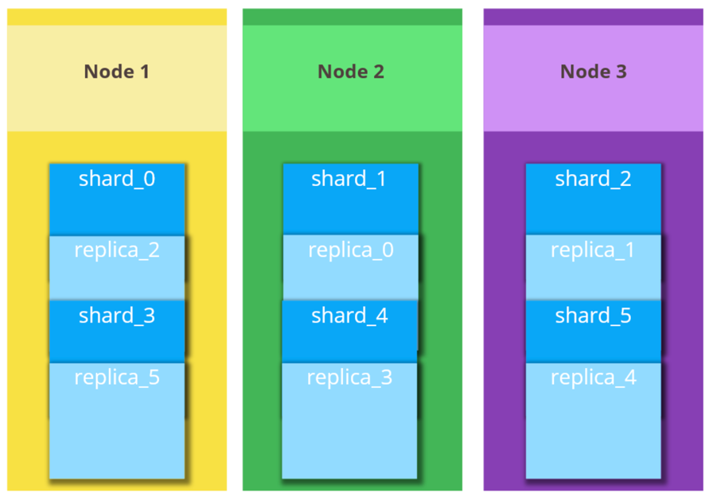
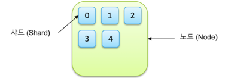
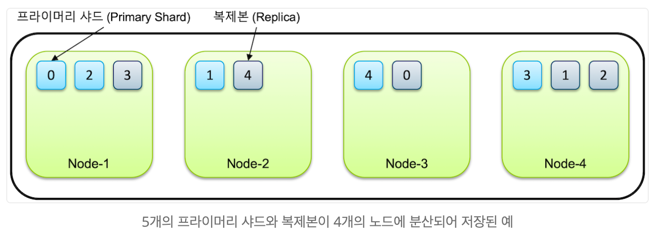

# Elasticsearch

> 로그, 검색, 분석 워크로드를 빠르게 처리하기 위한 분산 검색 엔진 정리

## 문서 정보

- 작성일: 2023-09-21
- 요구 지식: Java, 웹 기술, JSON

## 핵심 포인트

- Elasticsearch는 Apache Lucene 기반의 분산 검색 엔진임
- 문서(Document) 단위로 데이터를 저장하고, 인덱스와 샤드로 분산 처리함
- 검색 성능과 가용성을 위해 Primary Shard와 Replica 구조를 사용함

## Elasticsearch란

- 분산 시스템임
- NoSQL 계열의 문서 지향 저장소 성격을 가진 편임
- 로그 저장, 전문 검색, 집계 분석에 자주 사용됨
- 구조화 데이터와 비정형 데이터 모두 검색할 수 있음

## 주요 API

### 문서 API

- 단일 문서 조회, 생성, 수정, 삭제
- 다중 문서 조회, Bulk 적재

### 검색 API

- Query DSL 기반 검색
- 다중 인덱스 검색
- URL 기반 간단 검색
- 집계(Aggregation) 수행

### 인덱스 API

- 인덱스 생성, 조회, 삭제
- 별칭(Alias), 템플릿, 설정, 통계 관리

### 클러스터 API

- 클러스터 상태 확인
- 노드 통계 확인
- 보류 작업과 헬스 체크

## 시스템 구조



### Cluster

- 여러 Node가 모여 하나의 검색 클러스터를 이룸
- 운영 환경에서는 일반적으로 3개 이상의 Node 구성을 권장함

### Node 역할

- Data Node: 실제 색인 데이터 저장
- Master Node: 클러스터 상태와 메타데이터 관리
- Coordinating Node: 요청 분산과 결과 병합
- Ingest Node: 전처리 파이프라인 수행

### Shard와 Replica

- Shard는 인덱스를 분산 저장하기 위한 단위임
- Replica는 Primary Shard의 복제본임
- Replica는 장애 복구와 검색 처리량 향상에 도움을 줌

## Index와 Shard



- Index: Document 집합
- Primary Shard: 최초 저장 샤드
- Replica Shard: Primary 복제본

### 샤드 개수 설정

- `number_of_shards`는 인덱스 생성 시 결정함
- `number_of_replicas`는 운영 중에도 변경할 수 있음

```json
{
  "settings": {
    "number_of_shards": 5,
    "number_of_replicas": 1
  }
}
```

```json
{
  "number_of_replicas": 0
}
```



## Master Node와 Data Node

- Master Node는 클러스터 상태와 샤드 배치를 관리함
- Data Node는 실제 데이터 저장과 검색, 집계를 수행함
- Master 후보 노드를 별도로 두면 대형 클러스터 운영에 유리함

## 용어 정리

- Document: 단일 데이터 단위
- Index: Document를 모아둔 논리적 저장 단위
- Shard: 인덱스를 분산 저장하기 위한 물리 단위
- Replica: 샤드 복제본
- Indexing: 데이터를 Elasticsearch에 저장하는 과정
- Query DSL: JSON 기반 검색 질의 문법
- Bucket: 집계 결과를 그룹화한 단위
- Metric: 수치 기반 집계 결과

## 참고 자료

- [Elastic 가이드 북](https://esbook.kimjmin.net/02-install/2.1)
- [Elasticsearch 소개 글](https://coding-start.tistory.com/176)
