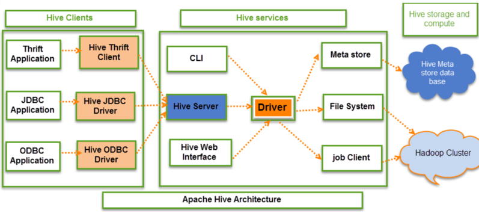
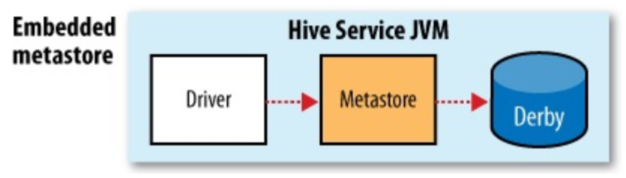
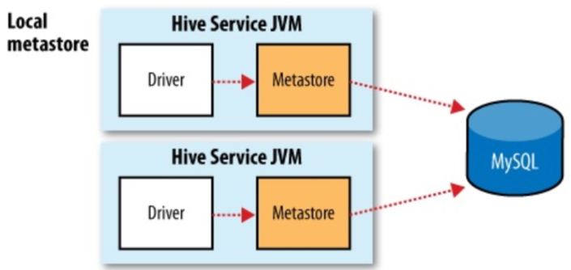
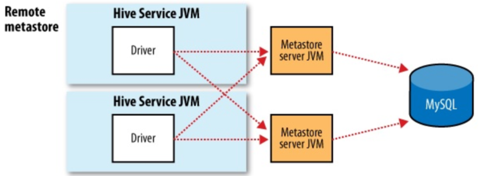
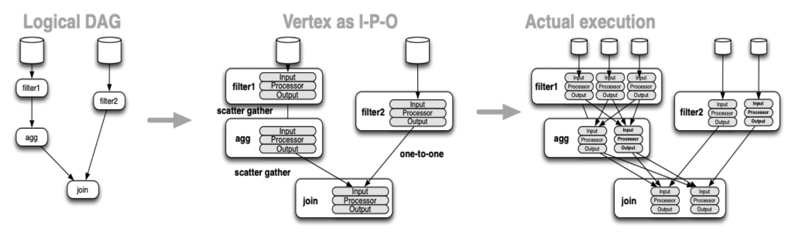
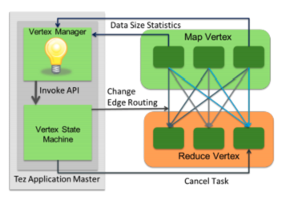
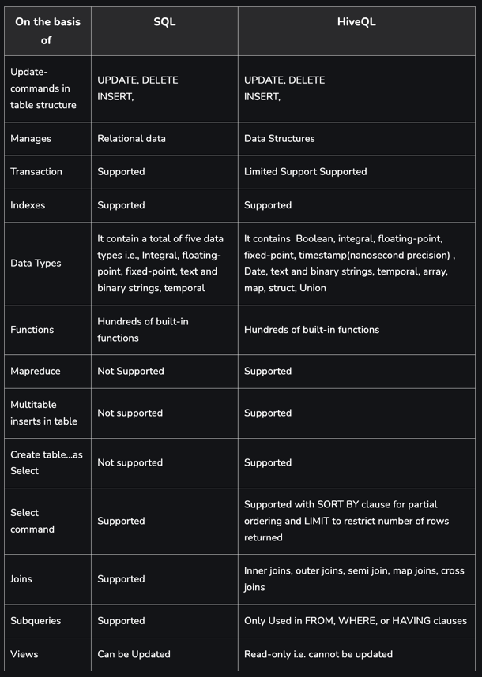
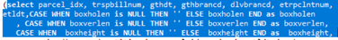

# Apache Hive

> HDFS 기반 데이터 웨어하우스 계층과 Hive 운영 포인트를 정리한 문서

## 문서 정보

- 작성일: 2023-08-01

## 핵심 포인트

- Hive는 HDFS 위에서 SQL 형태로 데이터를 조회하고 관리할 수 있게 해줌
- Metastore, Warehouse, 실행 엔진이 함께 동작해 테이블 기반 분석 환경을 만듦
- 배치성 분석과 대용량 테이블 운영에 강함

## Hive란

- Hadoop 생태계의 데이터 웨어하우스 도구임
- HiveQL(HQL)을 통해 SQL 유사 문법으로 데이터를 조회할 수 있음
- 내부적으로는 실행 엔진(MapReduce, Tez, Spark)과 연계해 작업을 수행함



## 아키텍처

### Hive Warehouse

- 실제 테이블 데이터가 저장되는 위치임
- Managed Table은 보통 Warehouse 경로 아래에 저장됨

### Metastore

- 테이블 스키마, 파티션, 위치, 설정 같은 메타데이터를 저장함
- Derby, MySQL, PostgreSQL 같은 데이터베이스를 사용할 수 있음

### 실행 모드

- Embedded: Derby 기반 단일 사용자 환경
- Local: 같은 JVM에서 외부 DB 사용
- Remote: 별도 프로세스로 Metastore 운영





## 내부 구조




## HiveQL과 SQL

- SQL은 관계형 데이터베이스를 다루는 표준 질의 언어임
- HiveQL은 Hadoop 데이터 분석을 위한 SQL 유사 문법임
- ORC, Parquet, Text, Sequence File 같은 파일 형식과 함께 자주 사용됨



## 성능 튜닝 포인트

### HQL

- 조건절에서 불필요한 UDF 사용 줄이기
- `COUNT(DISTINCT ...)` 남용 피하기
- 큰 테이블을 조인 순서의 뒤쪽에 두기
- `SELECT *` 대신 필요한 컬럼만 조회하기
- Vectorized Execution 활용하기
- 버킷팅과 파티셔닝을 목적에 맞게 사용하기

### SQL 공통

- 불필요한 인덱스 줄이기
- WHERE 절에서 함수 사용 최소화
- OR 조건 남용 줄이기

## 자주 겪는 문제

### Vertex error가 발생하는 경우

- 특정 컬럼이 전부 `null`인 상태에서 집계가 비정상적으로 커질 수 있음
- 벡터화 옵션과 null 처리 로직을 함께 점검함

```sql
set hive.vectorized.execution.enabled=true;
```



### 파티션 테이블 조회 결과가 비는 경우

- 메타데이터가 실제 파일 구조를 아직 반영하지 못한 경우가 많음
- `MSCK REPAIR TABLE table_name;`로 메타데이터를 갱신함

### `count(*)` 결과가 0건으로 나오는 경우

- 통계 정보가 오래된 경우가 있음
- `ANALYZE TABLE temp_table COMPUTE STATISTICS;`를 점검함

## Managed Table vs External Table

### Managed Table

- Warehouse 경로 아래에서 Hive가 데이터까지 함께 관리함
- 테이블 삭제 시 실제 데이터도 같이 제거될 수 있음

### External Table

- 데이터 위치를 별도로 지정함
- 테이블을 삭제해도 원본 파일은 유지됨

## Hive Transaction

- Hive 0.13 이후 트랜잭션 기능이 추가됐음
- ORC 기반, 버킷팅, 설정 조건을 함께 맞춰야 안정적으로 운영됨
- 변경 데이터는 `delta` 파일로 누적되고, compaction으로 정리함

### ACID

- Atomicity
- Consistency
- Isolation
- Durability

### 예시 DDL

```sql
CREATE TABLE test_hive_table (
  id int
)
CLUSTERED BY (id) INTO 10 BUCKETS
STORED AS ORC
TBLPROPERTIES (
  "transactional"="true"
);
```

## Hive 쿼리 동작 과정


1. 사용자가 Hive CLI 또는 JDBC/ODBC를 통해 쿼리를 보낸음
2. Driver가 쿼리를 파싱하고 실행 계획을 만듦
3. Metastore에서 필요한 메타데이터를 읽음
4. 실행 엔진이 실제 작업을 수행함
5. 결과를 다시 Driver를 통해 사용자에게 반환함

## 용어 정리

- SerDe: 직렬화/역직렬화 처리 계층
- Bucketing: 해시 기준 파일 분산
- Partitioning: 디렉터리 기준 데이터 분리
- Skew: 데이터 편향 현상
- HiveContext: Spark에서 Hive 메타스토어와 연동할 때 쓰던 컨텍스트
