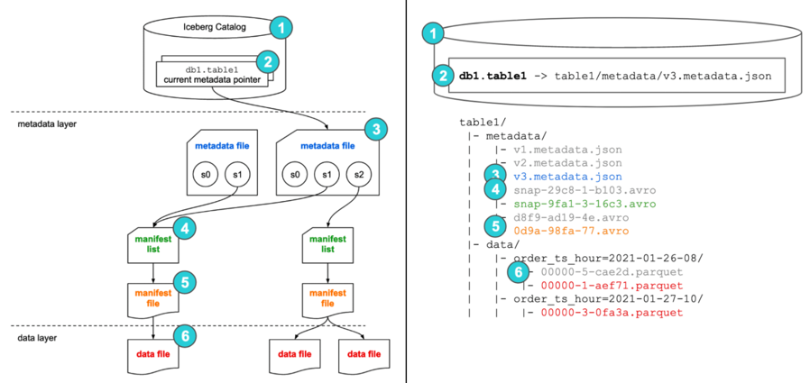

# Iceberg

> 대규모 분석 테이블을 안정적으로 운영하기 위한 오픈 테이블 포맷 정리

## 문서 정보

- 작성일: 2025-10-04

## 핵심 포인트

- Iceberg는 ACID와 스키마 진화를 지원하는 테이블 포맷임
- 데이터와 메타데이터를 분리해 관리함
- 대형 테이블에서 메타데이터 기반 pruning과 snapshot 관리가 강점임

## Iceberg란

- Transaction Data Lake를 위한 오픈 테이블 포맷임
- Spark, Hive, Flink, Presto/Trino 같은 엔진과 함께 사용할 수 있음
- Hidden Partitioning, Schema Evolution, Time Travel 기능을 제공함

## 아키텍처

1. 쿼리가 Catalog에 접근함
2. 대상 테이블의 최신 metadata 파일 위치를 찾음
3. metadata 파일에서 현재 snapshot과 manifest list를 찾음
4. manifest list에서 manifest 파일들을 확인함
5. manifest 파일에서 실제 데이터 파일 경로와 통계를 읽음
6. 필요한 데이터 파일만 스캔해 결과를 반환함

## Iceberg vs Delta Lake

### 공통점

- ACID 트랜잭션 제공
- 변경 이력 추적 가능
- 스키마 변경 지원

### Iceberg 특징

- Hidden Partitioning 지원
- 대형 분석 테이블 운영에 강함
- 엔진 독립성이 비교적 좋음
- Parquet, ORC, Avro 활용 가능

### Delta Lake

- Databricks 생태계와 결합이 강함
- 스트리밍 적재와 Upsert 워크로드에 자주 사용
- Delta Log 중심 메타데이터 관리
- 기본 파일 포맷은 Parquet

## 자주 묻는 질문

### 스트리밍 서비스에는 무엇이 더 적합한가

- 일반적으로 Delta Lake와 Spark Structured Streaming 조합이 더 많이 쓰임
- Iceberg는 대형 DW/DL 테이블과 장기 운영 관점에서 강점이 큼

### 파티션과 버킷의 차이는 무엇인가

| 구분 | 파티션 | 버킷 |
| --- | --- | --- |
| 기준 | 컬럼 값 | 컬럼 해시값 |
| 저장 단위 | 디렉터리 | 파일 |
| 장점 | 필터링 최적화 | Join, Shuffle 최적화 |
| 단점 | 파티션 과다 생성 가능 | 버킷 수 사전 결정 필요 |

- 카디널리티가 높은 컬럼은 파티션보다 버킷이 나을 수 있음

### 메타데이터 관리는 어떻게 보는가

- snapshot이 누적되면 메타데이터 비용도 증가함
- 주기적인 metadata 정리와 compaction 전략이 필요함
