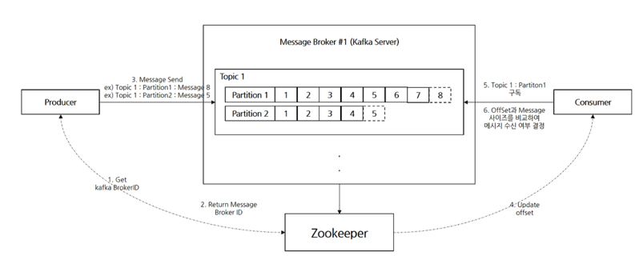
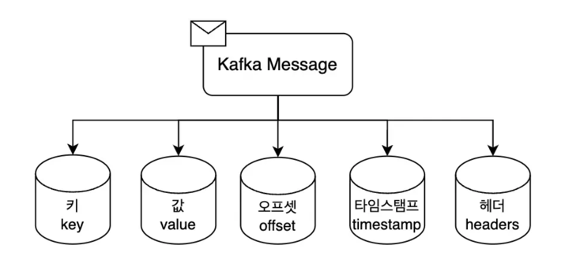

# Kafka

> 분산 메시징 시스템의 핵심 개념과 운영 시 자주 보는 용어를 정리한 문서

## 문서 정보

- 작성일: 2024-08-21

## 핵심 포인트

- Kafka는 Pub/Sub 기반 분산 메시지 브로커임
- Topic과 Partition을 통해 대용량 병렬 처리를 수행함
- Consumer는 offset으로 읽기 위치를 관리함

## Kafka란

- Producer와 Consumer 사이에서 메시지를 저장하고 전달하는 시스템임
- 높은 처리량과 확장성이 필요한 로그, 이벤트, 스트리밍 파이프라인에서 자주 사용됨
- 읽은 메시지를 즉시 제거하지 않고 보관 정책에 따라 유지할 수 있음

## 아키텍처

### Broker

- 메시지를 저장하고 전달하는 서버임

### Topic

- 메시지를 구분하는 논리 단위임

### Partition

- Topic 내부의 병렬 처리 단위임
- Consumer Group은 Partition 단위로 메시지를 나눠 처리함

### Producer

- 메시지를 생성해 Broker로 전송함

### Consumer

- Topic을 구독하고 메시지를 읽음

### ZooKeeper / KRaft

- 구버전 Kafka는 ZooKeeper를 사용했음
- 최신 Kafka는 KRaft 모드로 ZooKeeper 의존성을 줄이고 있음

## 메시지 구조

- `key`
- `value`
- `offset`
- `timestamp`
- `headers`

## 운영 관점 메모

- Partition 수는 병렬성과 운영 복잡도의 균형으로 결정함
- 메시지 순서는 Partition 단위로 보장됨
- 장애 대응 시 replication factor와 ack 정책이 중요함

## 용어 정리

- Queue: FIFO 구조
- Stack: LIFO 구조
- RabbitMQ: 대표적인 메시지 브로커
