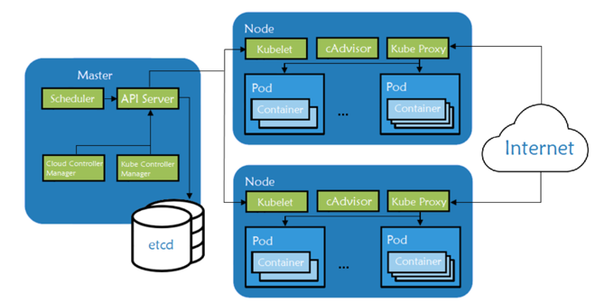
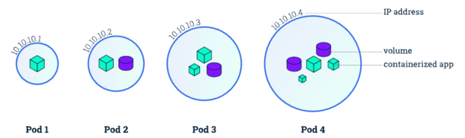
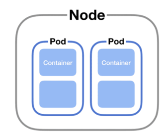
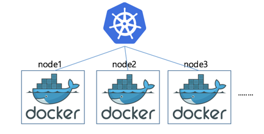

# Kubernetes

> 컨테이너 오케스트레이션의 핵심 개념과 데이터 플랫폼 관점의 활용 포인트 정리

## 문서 정보

- 작성일: 2024-03-13

## 핵심 포인트

- Kubernetes는 선언형 방식으로 컨테이너 서비스를 배포하고 운영함
- Pod는 Kubernetes가 관리하는 가장 작은 실행 단위임
- Airflow, Kubeflow 같은 데이터/ML 워크플로우와 자주 결합됨

## Kubernetes란

- 여러 Node에 애플리케이션을 분산 배포하는 오케스트레이션 플랫폼임
- 자동 배포, 재시작, 확장, 복구 기능을 제공함
- 운영 환경에서 표준 인프라 계층으로 자주 사용됨

## Pod

- 하나 이상의 컨테이너를 포함하는 최소 배포 단위임
- Pod 생명주기와 컨테이너 생명주기는 완전히 같지 않음

## Docker vs Kubernetes

### Docker

- 컨테이너 이미지 빌드와 실행에 강함
- 개별 컨테이너 단위 관리에 적합함

### Kubernetes 역할

- 다수의 컨테이너와 서비스를 클러스터 단위로 관리함
- 배포와 확장 자동화에 적합함

## Airflow vs Kubeflow

### Airflow

- 범용 워크플로우 오케스트레이션 도구임
- DAG 기반 배치·데이터 파이프라인 운영에 널리 쓰임

### Kubeflow

- Kubernetes 기반 머신러닝 워크플로우 플랫폼임
- 학습, 파이프라인, 서빙 자동화에 특화되어 있음

## Airflow + Kubernetes 사용 포인트

- DAG가 많아질수록 오토스케일링으로 리소스 운영이 쉬워짐
- `KubernetesPodOperator`로 작업 격리와 의존성 분리가 가능함
- 표준화되지 않으면 운영 복잡도가 빠르게 올라감
