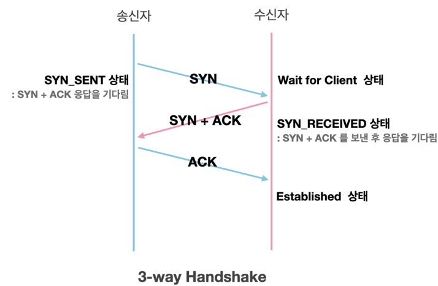
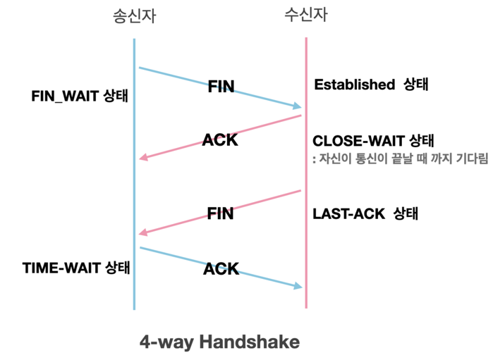
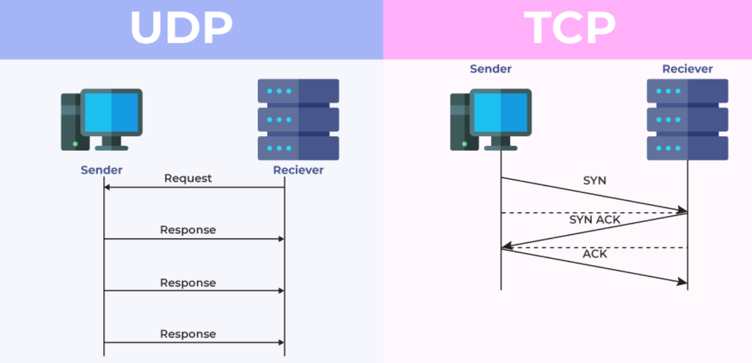
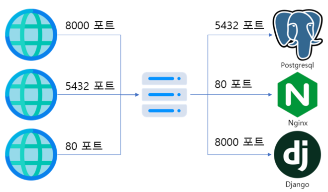

# Computer Network

> 서비스 운영과 데이터 파이프라인에서 자주 부딪히는 네트워크 기본 개념 정리

## 문서 정보

- 작성일: 2023-08-01

## 핵심 포인트

- HTTP/HTTPS는 애플리케이션 계층 통신 방식의 기본임
- TCP와 UDP는 전송 계층에서 신뢰성과 속도의 trade-off를 가진 편임
- 포트, 포워딩, SSH 같은 개념은 운영 환경에서 자주 직접 다루게 됨

## HTTP vs HTTPS

### HTTP

- Hypertext Transfer Protocol
- 기본 포트 `80`
- 암호화되지 않은 애플리케이션 계층 프로토콜

### HTTPS

- Hypertext Transfer Protocol Secure
- 기본 포트 `443`
- SSL/TLS 기반 암호화 통신

## HTTP 상태 코드

- `1xx`: 정보
- `2xx`: 성공
  - `200 OK`
  - `201 Created`
- `3xx`: 리다이렉션
- `4xx`: 클라이언트 오류
  - `400 Bad Request`
  - `403 Forbidden`
  - `404 Not Found`
  - `405 Method Not Allowed`
- `5xx`: 서버 오류
  - `500 Internal Server Error`
  - `502 Bad Gateway`
  - `503 Service Unavailable`

## HTTP 메서드

- Create: `POST`
- Read: `GET`
- Update: `PUT`
- Delete: `DELETE`

## TCP vs UDP

### TCP

- 연결 지향 방식
- 높은 신뢰성
- 3-way handshake로 연결
- 웹, 이메일, 파일 전송에 많이 사용

### UDP

- 비연결형 방식
- 빠르지만 신뢰성은 낮음
- 실시간 스트리밍, 음성·영상 전송에 자주 사용

## 포트 포워딩

- 외부 요청을 내부 서버 포트로 전달하는 방식임
- 예: `80:8000`은 외부 `80` 요청을 내부 `8000`으로 연결함

### 자주 보는 포트

- HTTP: `80`
- HTTPS: `443`
- PostgreSQL: `5432`
- Django: `8000`
- SSH: `22`

## SSH / SCP

- SSH는 원격 서버 접속 프로토콜임
- SCP는 SSH 기반 파일 전송 도구임
- 공개키/개인키 인증 방식을 주로 사용함
