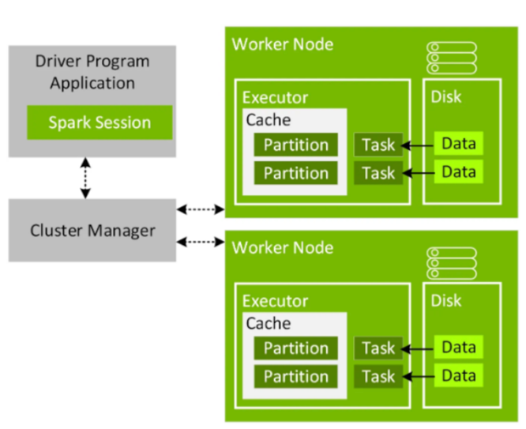

# Apache Spark

> 대규모 데이터 처리와 실시간 분석에 자주 쓰이는 Spark의 핵심 개념 정리

## 문서 정보

- 작성일: 2025-05-12
- 관련 문서: [install_spark](/Users/jykim/Documents/private/data-engineer/document/platform/install_spark.md)

## 핵심 포인트

- Spark는 범용 분산 처리 엔진임
- 메모리 기반 처리와 RDD lineage를 통해 빠른 연산과 복구를 지원함
- ETL, SQL, 스트리밍, ML, 그래프 처리까지 영역이 넓은 편임

## Spark란

- 대규모 데이터를 병렬 처리할 수 있는 분산 시스템임
- 장애 발생 시 lineage 정보를 통해 데이터를 복구할 수 있음
- Spark Core, SQL, Streaming, MLlib, GraphX 모듈로 구성됨

## 실행 구조

### 구성 요소

- Driver Application: 전체 작업 조정
- Cluster Manager: 리소스 할당
- Executor: 실제 Task 실행

### 동작 흐름

1. `SparkSession`이 실행 계획과 리소스 정보를 바탕으로 작업을 시작함
2. Cluster Manager가 Executor를 할당함
3. Executor가 데이터를 읽어 Task 단위로 처리함
4. 파티션 간 데이터 이동이 필요하면 shuffle이 발생함
5. 결과가 Driver에 모여 사용자에게 반환됨

## Spark Streaming

- 마이크로배치 또는 구조적 스트리밍으로 실시간 데이터를 처리함
- Kafka와 함께 자주 사용됨

## 비교 포인트

### Spark vs Hadoop MapReduce

- Spark: 메모리 기반, 반복 연산에 강함
- MapReduce: 디스크 기반, 단순 대규모 배치 처리에 강함

### Spark vs Hive

- Spark: 범용 처리 엔진
- Hive: SQL 중심 데이터 웨어하우스 계층
