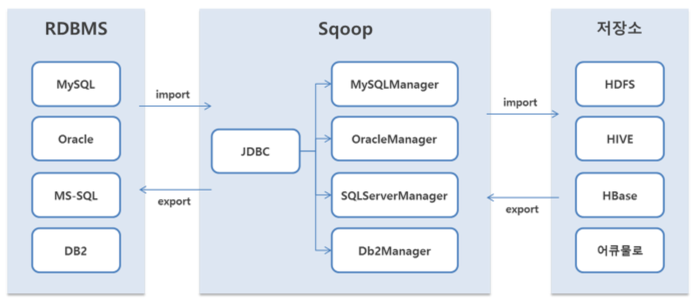
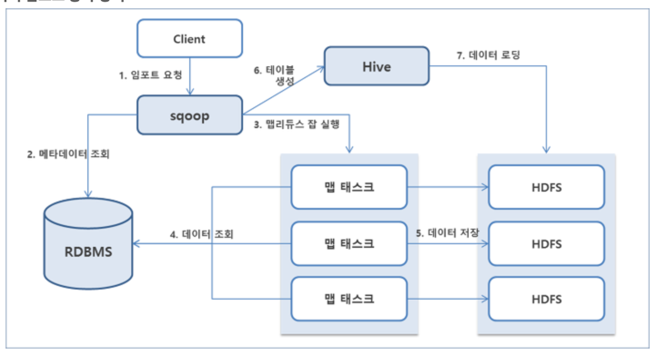
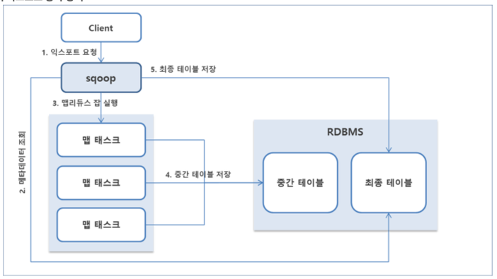

# Apache Sqoop

> 관계형 데이터베이스와 Hadoop 저장소 사이의 데이터 이동 도구를 정리한 문서

## 문서 정보

- 작성일: 2023-07-01
- 환경: macbook pro14 m2 (silicon)

## 핵심 포인트

- Sqoop은 RDBMS와 HDFS 간 대량 데이터 전송에 특화되어 있음
- `import`와 `export` 작업을 지원함
- 내부적으로 MapReduce 기반 병렬 처리를 활용함

## Sqoop이란

- 관계형 데이터베이스와 Hadoop 저장소 사이에서 데이터를 옮기는 도구임
- 배치성 적재 작업에 자주 사용됨

## 동작 방식

### Import (`RDBMS -> HDFS`)

1. 클라이언트가 `sqoop import`를 요청함
2. RDBMS 메타데이터를 조회함
3. MapReduce 작업이 실행됨
4. Mapper가 데이터를 읽어 병렬 처리함
5. 결과가 HDFS에 적재됨

### Export (`HDFS -> RDBMS`)

1. 클라이언트가 `sqoop export`를 요청함
2. 대상 RDBMS의 적재 대상 정보를 확인함
3. MapReduce 작업이 실행됨
4. Mapper가 데이터를 병렬 전송함
5. 결과가 RDBMS에 반영됨

